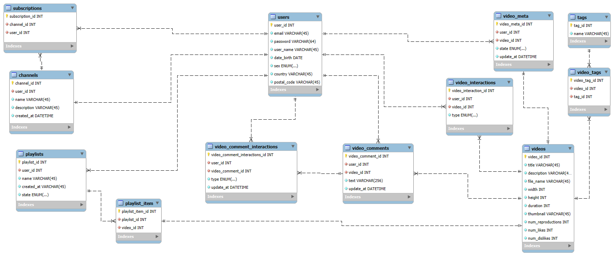

# task-mysql-structures 

##  Enunciat de l'exercici

**Tractarem de fer un model senzill de com seria la base de dades per a una versió reduïda de YouTube.**

- De cada usuari/ària guardem un identificador únic:
    - Email.
    - Password.
    - Nom d'usuari/ària.
    - Data de naixement.
    - Sexe.
    - País.
    - Codi postal.

- Un usuari/ària publica vídeos. De cada vídeo guardem un identificador únic:
    - Un títol.
    - Una descripció.
    - Una grandària.
    - El nom de l'arxiu de vídeo.
    - Durada del vídeo.
    - Un thumbnail.
    - El nombre de reproduccions.
    - El número de likes.
    - El número de dislikes.
- Un vídeo pot tenir tres estats diferents: públic, ocult i privat. Un vídeo pot tenir moltes etiquetes. Una etiqueta s'identifica per un identificador únic i un nom d'etiqueta. Interessa guardar qui és l'usuari/ària que publica el vídeo i en quina data/hora el fa.

- Un usuari/ària pot crear un canal. Un canal té un identificador únic:
    - Un nom.
    - Una descripció.
    - Una data de creació.

- Un usuari/ària es pot subscriure als canals d'altres usuaris/es. Un usuari/ària pot donar-li un like o un dislike a un vídeo una única vegada. Caldrà portar un registre dels usuaris/es que li han donat like i dislike a un determinat vídeo i en quina data/hora ho van fer.

- Un usuari/ària pot crear playlists amb els vídeos que li agraden. Cada playlist té un identificador únic:
    - Un nom.
    - Una data de creació.
    - Un estat que indica que pot ser pública o privada.

- Un usuari/ària pot escriure comentaris en un vídeo determinat. Cada comentari està identificat per un identificador únic:
    - El text del comentari.
    - La data/hora en la qual es va realitzar.

- Un usuari/ària pot marcar un comentari com m'agrada o no m'agrada. Caldrà portar un registre dels usuaris/es que han marcat un comentari com m'agrada/no m'agrada, i en quina data/hora ho van fer.

## 🛠 Tecnologies  
- MySQL - MySQL Workbench 8

## 🚀 Instal·lació i Execució
1. Clonar el repositori: `git clone ...`   
2. Visualitzar el diagrama
3. Variables d'entorn: Crear `.env` amb...  
    - MYSQL_ROOT_PASSWORD=ReplaceWithAStrongRootPassword
    - MYSQL_PASSWORD=ReplaceWithAStrongAppPassword
4. Per executar el mysql container: `cd ... fins al nivell de directori corresponent del archiu 'docker-compose.yml'`

    ```docker
    # Build the images
    docker compose build

    # Start the containers
    docker compose up -d

    # Check running containers
    docker compose ps

    # View logs
    docker compose logs -f

    # Stop the application
    docker compose down
    ```
5. Per executar el script de creació i populació del schema, tables and data:
    - MySQL Workbench: run the script from the GUI
    - SQL SHELL (CLI):

        ```docker
            # Copy script file from WINDOWS to container
            docker cp "C:\Users\YourName\Desktop\sql-...-create.sql" mysql-container:/tmp/init.sql

            # Open the sql shell inside the container
            docker exec -it mysql-container mysql -u root -p

            # Execute the script from inside the MySQL shell
            'SOURCE /tmp/init.sql;' or '\. /tmp/init.sql'
        ```

## 🧩 Diagrames i justificació de decisions tècniques

### Youtube Entity Relationships
